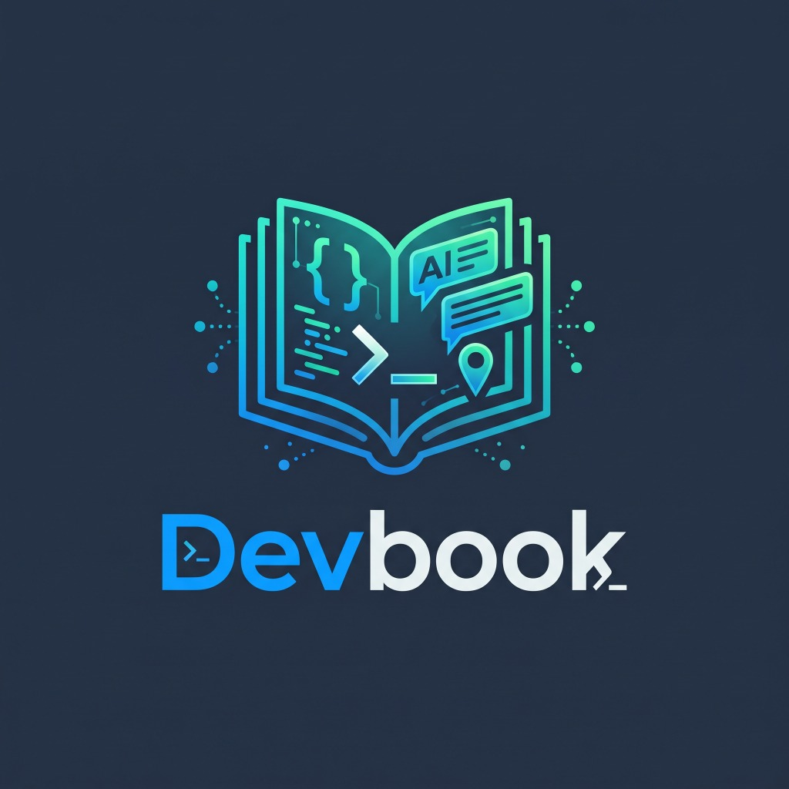
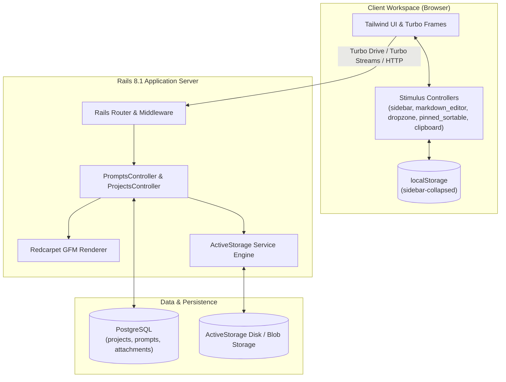

<p align="center">
  
</p>

# Devbook

<p align="center">
  <strong>A local-first prompt engineering studio and workspace for developers.</strong>
</p>

<p align="center">
  <a href="https://ruby-lang.org"></a>
  <a href="https://rubyonrails.org"></a>
  <a href="https://hotwired.dev"></a>
  <a href="https://tailwindcss.com"></a>
  <a href="https://www.postgresql.org"></a>
  
  <a href="https://github.com/leouofa/devbook-mcp"></a>
</p>

---

## Overview

Software engineers and AI practitioners frequently juggle complex system prompts, few-shot examples, and model instructions scattered across scratchpads, notes apps, and one-off gists.

**Devbook** is a dedicated, distraction-free desktop prompt workbench designed to be run locally. It lets you organize, author, preview, and test prompt templates grouped by project or kept as standalone scratchpads—with instant one-click markdown copying, live split-screen previewing, drag-and-drop context file attachments, and pinned prompt management.

---

## Key Features

### 📁 Project & Standalone Organization
- **Structured Hierarchy**: Organize prompts inside dedicated projects (e.g., `Architecture Review`, `API Generators`, `Code Migrations`).
- **Standalone Prompts**: Keep loose scratchpad prompts without forcing project assignment.
- **Fluid Assignment**: Reassign any prompt to any project or back to standalone anytime via a quick dropdown.
- **Real-Time Search**: Instant client-side prompt and project filtering from the persistent sidebar.

### 📝 Markdown Editing with 3 View Modes
- **Preview Mode**: Clean GitHub Flavored Markdown (GFM) rendering powered by `Redcarpet` with dark-mode developer typography, fenced syntax highlighting blocks, and GitHub-style tables.
- **Edit Mode**: Monospaced raw Markdown editor with debounced auto-save and visual save status indicators.
- **Split Mode**: Side-by-side split screen providing live editor feedback alongside real-time rendered markdown.
- **Save Shortcut**: `⌘S` / `Ctrl+S` instant save from anywhere in the editor.

### ⚡ Zero-Latency One-Click Copy
- **Prompt Toolbar**: Prominent `Copy Markdown` button on the prompt workspace header.
- **Prompt Cards**: Quick `Copy` action directly on every card in project and index listings.
- **Immediate Feedback**: Instant visual cue transitioning to `Copied!` with highlight styling.

### 📌 Pinned Prompts & Reordering
- **Sidebar Quick Access**: Pin your most critical prompts to the top of the sidebar.
- **Drag-and-Drop Reordering**: Smooth client-side reordering persisted to the database via `pinned_position`.
- **Global Toggle**: Quick-pin or unpin prompts directly from cards or detail toolbars.

### 📎 ActiveStorage Dropzone Context Attachments
- **Drag-and-Drop Uploads**: Direct ActiveStorage file uploads with drag-and-drop dropzones on prompt pages without full-page reloads.
- **Rich Attachment Previews**: Image thumbnail rendering, formatted human-readable file sizes, download links, and instant attachment purging via Turbo Streams.

### 🖥️ Collapsible Workspace & Mobile Ergonomics
- **Collapsible Sidebar**: Toggle with `⌘\` / `Ctrl+\` or via the top-bar button.
- **Preference Persistence**: Sidebar collapse state is remembered across refreshes and page transitions via `localStorage`.
- **Mobile First-Class Drawer**: On mobile screens (< 768px), the sidebar expands to full width with main view masking, automatically closing upon link selection for seamless navigation.

### 🤖 Model Context Protocol (MCP) & REST API
- **Official MCP Server**: Connect AI coding assistants (Claude Desktop, Cursor, Gemini, Antigravity) directly to Devbook via [`devbook-mcp`](https://github.com/leouofa/devbook-mcp).
- **RESTful API & OpenAPI 3.1**: Full programmatic endpoints for prompts, projects, attachments, search, and markdown rendering.

---

## Architecture & Tech Stack

Devbook is built on a lightweight, high-performance Rails 8 stack engineered for maximum developer ergonomics without the complexity of a separate single-page application framework.

| Layer | Technology | Purpose |
| :--- | :--- | :--- |
| **Backend** | Ruby 3.4.4 / Rails 8.1.4 | Core MVC engine, Turbo stream responses, ActiveStorage services |
| **Database** | PostgreSQL | Relational storage for projects, prompts, pinned positions, and attachments |
| **Frontend Reactive** | Hotwire (Turbo 8 + Stimulus) | SPA-speed transitions, frame updates, and modular JavaScript controllers |
| **Styling** | Tailwind CSS v4 | High-performance compiled modern utility-first stylesheet |
| **Markdown Engine** | Redcarpet 3.6 | Server-side GitHub Flavored Markdown parsing with HTML sanitization |
| **Asset Pipeline** | Propshaft + Importmap | Zero-Node ESM JavaScript loading with instant startup |
| **Testing** | Minitest + Capybara + Selenium | Full unit, integration, and end-to-end browser system test coverage |

### System Flow Diagram



---

## Keyboard Shortcuts

| Shortcut | Action | Scope |
| :--- | :--- | :--- |
| `⌘ \` / `Ctrl + \` | Toggle Sidebar (Collapsed / Expanded) | Global |
| `⌘ S` / `Ctrl + S` | Force Save Prompt Content | Prompt Edit / Split Modes |
| `Click Nav Link` | Auto-close Sidebar Drawer | Mobile View (< 768px) |

---

## Design Philosophy & Engineering Decisions

- **Local-First & Zero-Auth by Design**: Personal prompt engineering shouldn't require creating third-party cloud accounts, paying subscriptions, or dealing with network latencies. Devbook is designed to run locally on your development machine, keeping your intellectual property and confidential prompt instructions private.
- **Hotwire Over Heavy SPAs**: By leveraging Rails 8 Turbo Frames, Turbo Streams, and targeted Stimulus controllers, Devbook delivers the snappy, single-page responsiveness of React or Vue without the overhead of client-side state hydration, duplicate routing, or Node build step dependencies.
- **Direct ActiveStorage Attachments**: Prompt contexts often require sample payloads, API documentation, or image reference fixtures. Integrating directly with ActiveStorage allows prompts to bundle context files without relying on external cloud file hosting.

---

## Local Development Quickstart

### Prerequisites
- **Ruby**: `3.4.4` (managed via `rbenv`, `asdf`, or `mise`)
- **PostgreSQL**: `14+` running locally
- **Bundler**: `bundle -v`

### 1. Clone the Repository
```bash
git clone https://github.com/leouofa/devbook.git
cd devbook
```

### 2. Setup Dependencies & Database
Run the setup script to install gems, prepare the database, and compile assets:
```bash
bin/setup
```

*(Alternatively, run step-by-step)*:
```bash
bundle install
bin/rails db:prepare
```

### 3. Seed Sample Data (Optional)
Populate sample projects, markdown prompts, and patterns:
```bash
bin/rails db:seed
```

### 4. Start the Development Server
Launch the unified Tailwind watcher and Puma server:
```bash
bin/dev
```
Open your browser at [http://localhost:3000](http://localhost:3000).

---

## Running the Test Suite

Devbook maintains full test coverage across models, controllers, and browser interactions.

```bash
# Run unit and controller test suite
bin/rails test

# Run browser system tests (Capybara + headless Chrome)
bin/rails test:system

# Run RuboCop linter (Rails Omakase style)
bin/rubocop

# Security audits
bin/brakeman --no-pager
bin/bundler-audit
```

---

## REST API & MCP Integration

Devbook includes a complete versioned RESTful JSON API (`/api/v1`) with full OpenAPI 3.1.0 specifications, designed for easy programmatic integration and Model Context Protocol (MCP) server integration.

### Official Model Context Protocol (MCP) Server

Connect Devbook directly to your AI coding agents, IDEs, and assistant workflows (such as Claude Desktop, Cursor, Gemini, and Antigravity) using the official MCP server:

🔗 **[Devbook MCP Server (`devbook-mcp`)](https://github.com/leouofa/devbook-mcp)**

The MCP server provides dedicated tools for AI agents to:
- Browse, search, read, create, and update prompts and projects
- Toggle and reorder pinned prompts
- Inspect and manage ActiveStorage file attachments
- Render Markdown via Devbook's server-side Redcarpet pipeline

### OpenAPI Specification
- **Live Endpoint**: `GET http://localhost:3000/api/v1/openapi.json`
- **Specification File**: [`openapi.json`](file:///Users/leonid/src/devbook/openapi.json) located in repository root

### API Endpoints Summary

| Method | Endpoint | Description |
| :--- | :--- | :--- |
| `GET` | `/api/v1/stats` | System statistics (total prompts, projects, attachments) |
| `GET` | `/api/v1/openapi` | OpenAPI 3.1.0 schema specification |
| `POST` | `/api/v1/markdown/render` | Render raw Markdown text to sanitized HTML |
| `GET` | `/api/v1/projects` | List projects with prompt counts and search (`?q=...`) |
| `POST` | `/api/v1/projects` | Create a new project |
| `GET` | `/api/v1/projects/:id` | Get project details and associated prompts |
| `PATCH` | `/api/v1/projects/:id` | Update project attributes |
| `DELETE` | `/api/v1/projects/:id` | Delete project (preserves prompts as standalone) |
| `GET` | `/api/v1/prompts` | List prompts (filter by `project_id`, `scope`, `pinned`, `q`) |
| `POST` | `/api/v1/prompts` | Create a new prompt |
| `GET` | `/api/v1/prompts/:id` | Get prompt details (`?render_markdown=true` for HTML) |
| `PATCH` | `/api/v1/prompts/:id` | Update a prompt |
| `DELETE` | `/api/v1/prompts/:id` | Delete a prompt |
| `PATCH` | `/api/v1/prompts/:id/toggle_pin` | Toggle pinned state of a prompt |
| `PATCH` | `/api/v1/prompts/reorder_pinned` | Reorder pinned prompts (`{ prompt_ids: [...] }`) |
| `GET` | `/api/v1/prompts/:id/attachments` | List prompt attachments with metadata and URLs |
| `POST` | `/api/v1/prompts/:id/attachments` | Upload file attachments (`multipart/form-data`) |
| `DELETE` | `/api/v1/prompts/:id/attachments/:att_id` | Purge attachment |

---

## License

This project is open-source and available under the MIT License.
